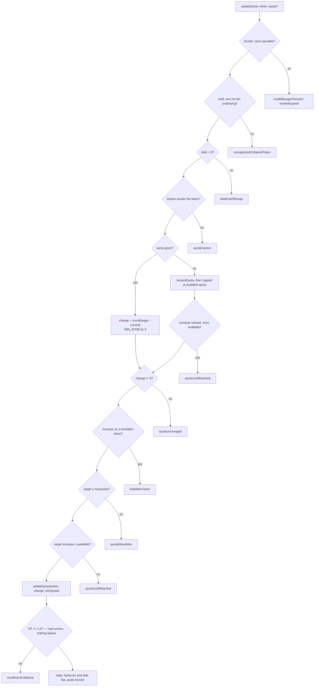

# Update quota

`prepare.updateQuota` → `startIntent({ type: "UPDATE_QUOTA" })` →
`planUpdateQuota` ([`plan.ts`](../../src/onchain/accounts/intents/plan.ts)) →
`resolveQuotaUpdate` ([`resolveQuotaUpdate.ts`](../../src/onchain/accounts/intents/resolveQuotaUpdate.ts)).

One token's quota changes and nothing else does: no balance moves, the debt is
untouched. What changes is how much of the token counts as collateral — a
quoted token counts up to its quota and for nothing without one — and the quota
fee the account pays for it.

Only a token the account already holds can be quoted, and only on an account
with nonzero debt: the facade refuses any quota change at zero debt.

## Two modes

| `quota`   | What is sent                                                         | `minQuota`                                  |
| --------- | -------------------------------------------------------------------- | ------------------------------------------- |
| `0n` or below | `updateQuota(token, MIN_INT96)`, which disables it                | `0`                                         |
| a target  | the change to it, rounded toward zero to a `PERCENTAGE_FACTOR` step   | the resulting quota: strict                 |
| omitted   | the change to the balance's size, capped at the pool's available quota | increase: `max(current, 10_000)`; decrease: the resulting quota |

An omitted quota is sized by the same path every other intent's closing quota
update takes (`resizedQuota`, beside `getQuotasForUpdate`): the balance's value
in the underlying × LT, with `quotaReserve` on top, an increase capped by
`2 · maxDebt` minus every quota the account holds, a full decrease sent as the
sentinel. The pool's available quota is the one cap that path does not know; a partial
fill is accepted, so long as the token stays enabled.

`0n` means "disable", never "size it": only an omitted field picks the second
mode.

## Math

```text
target mode:  change = roundUpQuota(max(quota, 0) − current)     MIN_INT96 for 0
auto mode:    desired = roundUpQuota(valueᵤ · LT · (1 + reserve))
              change  = min(desired − current, 2·maxDebt − Σ quotas, available)   on an increase
maxQuota    = 2 · maxDebt                                          per token, target mode
available   = roundUpQuota(limit − totalQuoted)
```

## Graph



## Notes

- The closing quota update every other intent ends with is skipped: the step
  sets the one quota the intent names, and the balances, which did not move,
  have nothing to add.
- The enabled-token count is not checked here; enabling one token too many is
  `checkSimulation`'s `quotaCountExceeded`.
- The quota increase fee is added to the debt on-chain and is not modelled.
- A parsed `updateQuota` is replayed with the same rounding, but not capped at the
  pool's available quota: `checkIncreaseQuota` has to see the full request to refuse it.
  `checkOperation` also runs `checkQuotaUpdates`, which refuses an increase on a
  forbidden token or on an account that ends with zero debt, and a resulting
  quota above `maxQuota`.
- Tests: [`update-quota.onchain.test.ts`](../../src/onchain/accounts/intents/tests/update-quota.onchain.test.ts),
  [`resolveQuotaUpdate.test.ts`](../../src/onchain/accounts/intents/resolveQuotaUpdate.test.ts).
